# Rust apps: screenshots

Taken on a Linux virtual screen (no game, no stations online, fresh settings), so live parts are empty.

## Controller · Show setup (opens on first start)
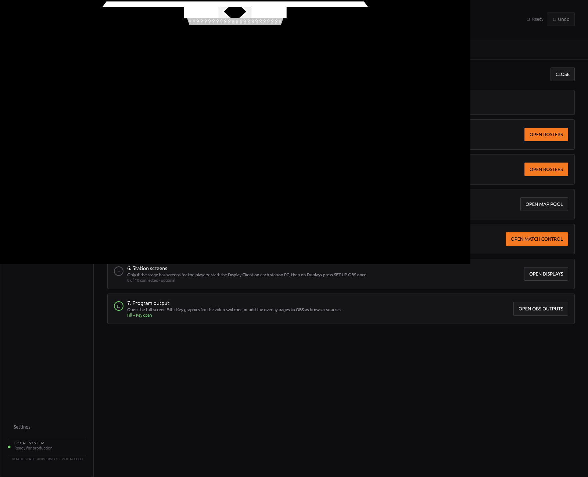

## Controller · Match Control (VALORANT)
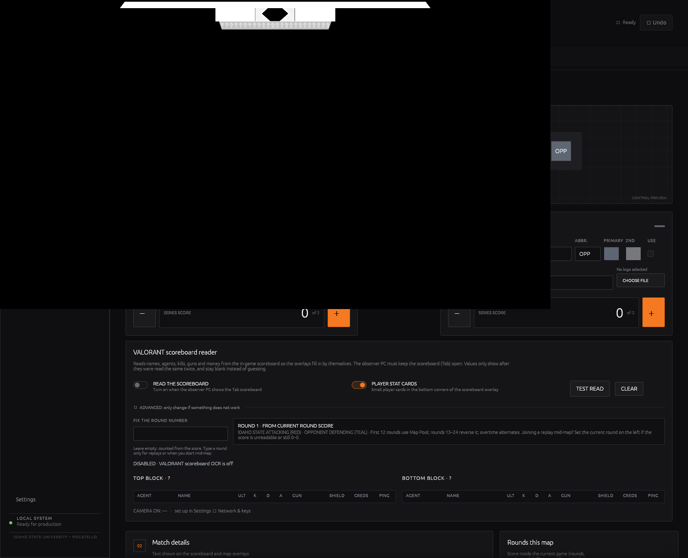

## Controller · Match Control (Rocket League)
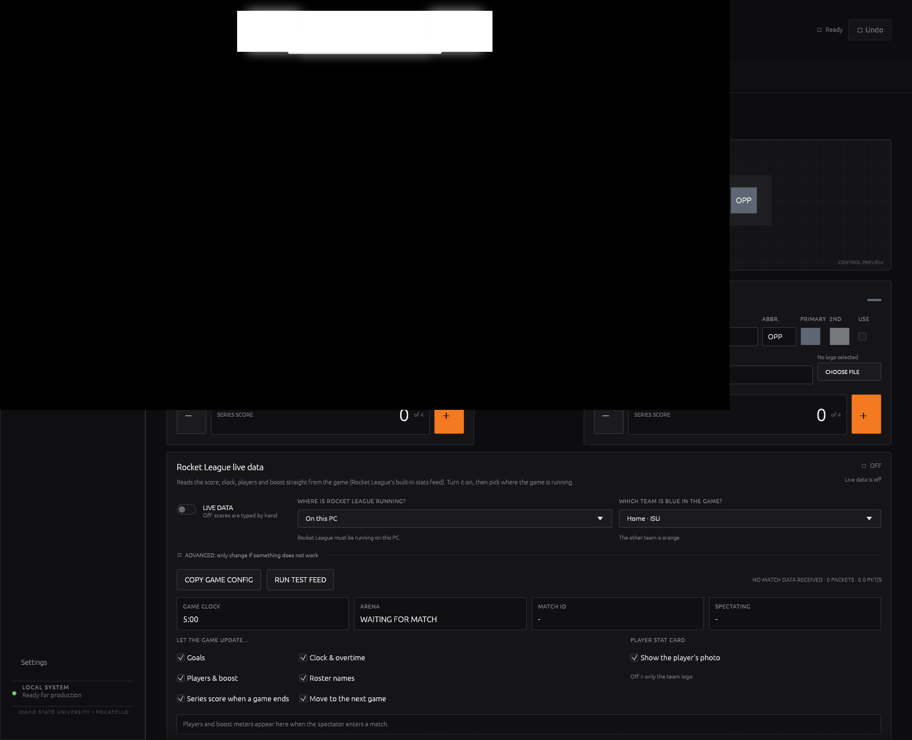

## Controller · Map Pool (VALORANT)
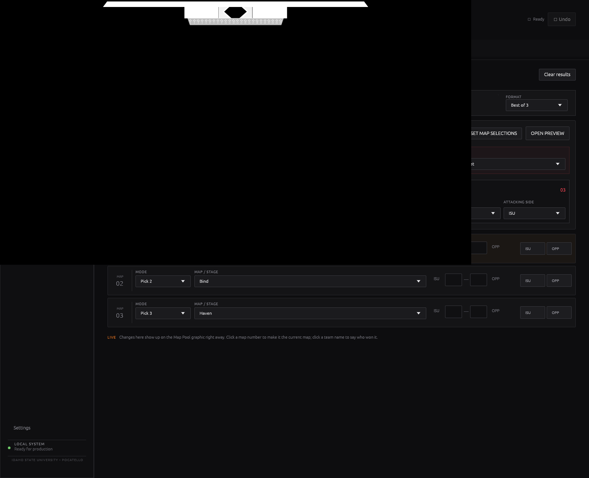

## Controller · Rosters
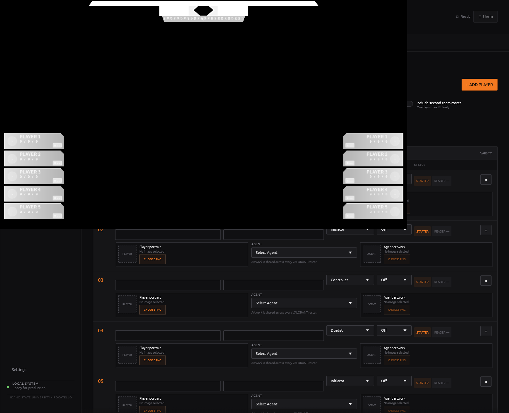

## Controller · OBS Outputs
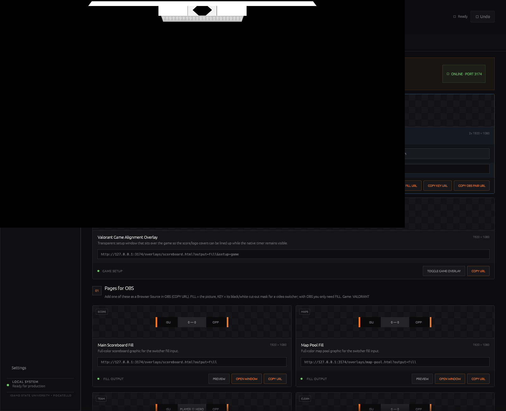

## Controller · Displays
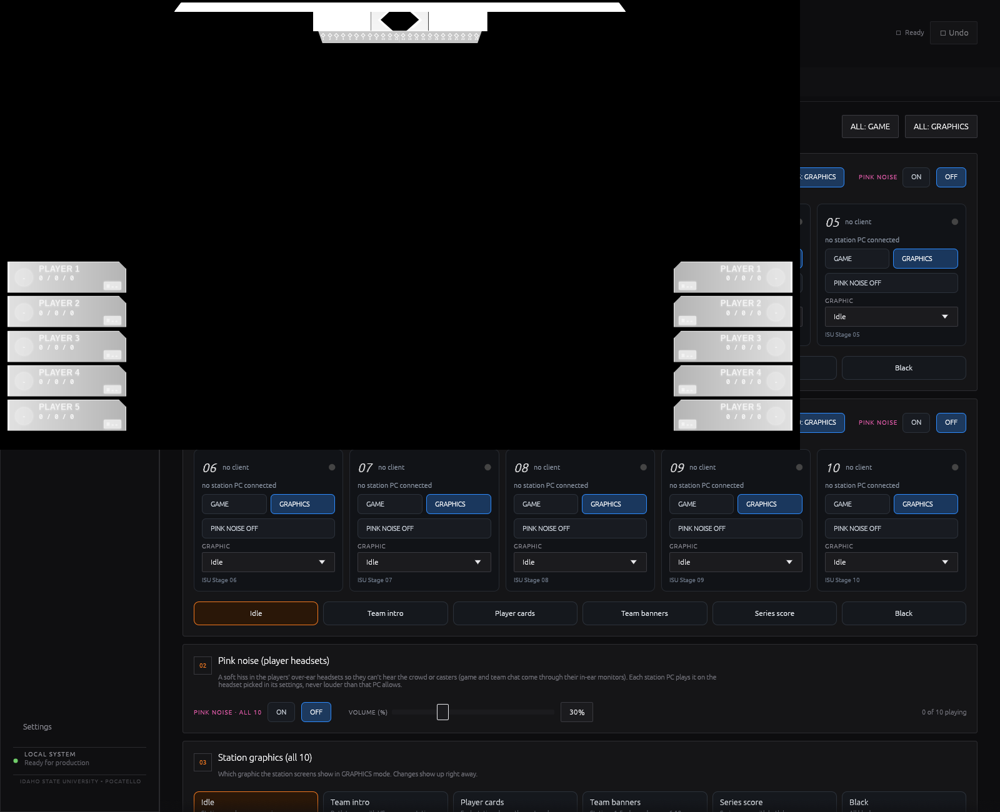

## Controller · Settings
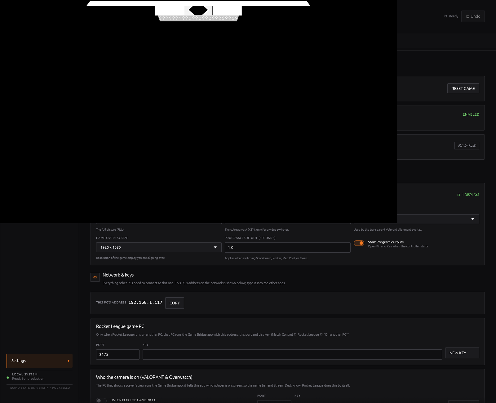

## Game Bridge · VALORANT
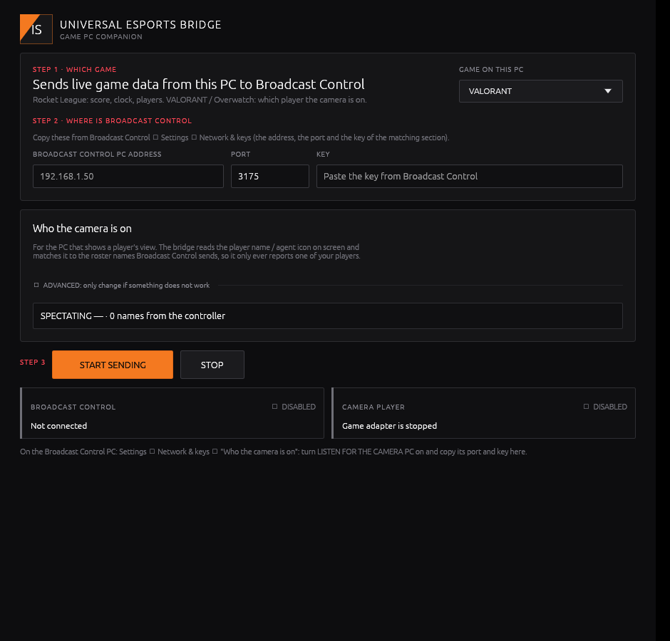

## Game Bridge · Rocket League
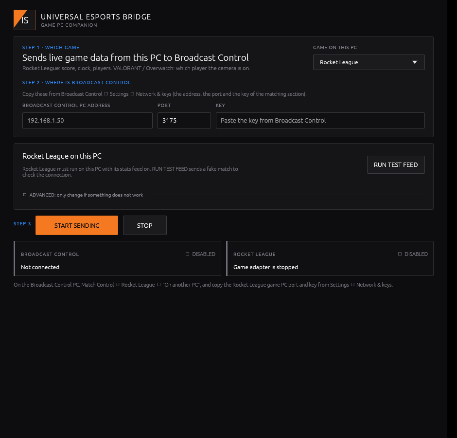

## Display Client · Settings (Ctrl+Alt+S)
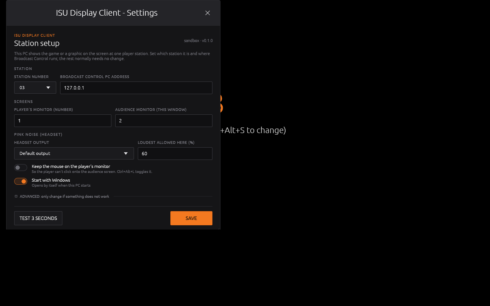

